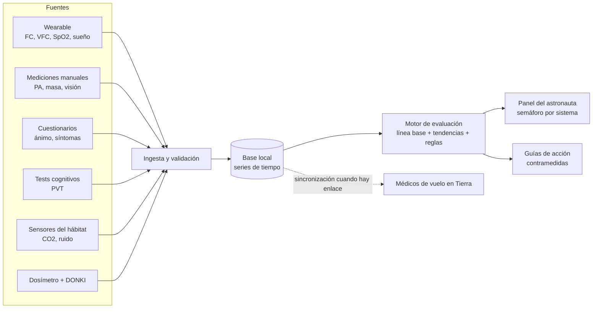

# 6. Propuesta de arquitectura del software

## 6.1 Principios (derivados de la documentación NASA)

| Principio | Por qué | Fuente |
|---|---|---|
| **Offline‑first** | Retraso de comunicaciones y sin evacuación | [5 Hazards](https://www.nasa.gov/hrp/hazards/) (Distancia) |
| **Línea base personal** | NASA vigila a cada astronauta en el tiempo | [TB‑043](https://www.nasa.gov/wp-content/uploads/2023/12/ochmo-tb-043-longitudinal-health-surveillance.pdf) |
| **Baja carga cognitiva** | Tripulación con mucho trabajo y fatiga | [TB‑032](https://www.nasa.gov/wp-content/uploads/2023/12/ochmo-tb-032-cognitive-workload.pdf), [TB‑005](https://www.nasa.gov/wp-content/uploads/2023/12/ochmo-tb-005-usability.pdf) |
| **Alertas accionables** | El astronauta debe "actuar en consecuencia" | Enunciado del reto |
| **Privacidad de salud mental** | Confianza para reportar con honestidad | [TB‑016](https://www.nasa.gov/wp-content/uploads/2023/12/ochmo-tb-016-behavioral-health.pdf) |

## 6.2 Diagrama de componentes



## 6.3 Modelo de datos mínimo

```json
{
  "medicion": {
    "astronauta_id": "A01",
    "timestamp": "2026-11-14T08:00:00Z",
    "sistema": "cardiovascular",
    "indicador": "frecuencia_cardiaca_reposo",
    "valor": 62,
    "unidad": "lpm",
    "fuente": "wearable",
    "calidad": 0.95
  },
  "linea_base": {
    "astronauta_id": "A01",
    "indicador": "frecuencia_cardiaca_reposo",
    "media": 58, "desviacion": 3.1, "periodo": "preflight-90d"
  },
  "alerta": {
    "nivel": "amarillo",
    "indicador": "frecuencia_cardiaca_reposo",
    "motivo": "+1.3 DE sobre la línea base durante 3 días",
    "accion_sugerida": "Revisar hidratación y sueño; repetir medición mañana",
    "referencia": "NASA-STD-3001 Vol.1; HRP cardiovascular risk"
  }
}
```

## 6.4 Reglas de ejemplo para el motor de evaluación

| Regla | Nivel |
|---|---|
| Indicador fuera de ±1 DE de la línea base durante ≥3 días | 🟡 |
| Indicador fuera de ±2 DE o tendencia sostenida de 14 días | 🔴 |
| Evento SEP activo en DONKI | 🔴 Radiación: ir al refugio |
| Dosis acumulada > 50 % / 80 % del límite de carrera (600 mSv) | 🟡 / 🔴 |
| Sueño < 6 h durante 3 noches seguidas | 🟡 Fatiga |
| PVT más lento que la línea base + ánimo bajo | 🟡 Salud conductual |
| Síntomas visuales nuevos | 🔴 Protocolo SANS |
| CO₂ por encima del límite del Vol. 2 | 🔴 Entorno |

> Los umbrales exactos deben tomarse de la versión vigente de NASA‑STD‑3001 y validarse con expertos; los de esta tabla son ilustrativos para el prototipo.

## 6.5 Alcance de MVP para el reto

1. Registro diario rápido (≤ 2 min): ánimo, sueño, síntomas, masa corporal.
2. Importación de un CSV/JSON de wearable con datos sintéticos.
3. Panel semáforo por sistema (cardio, óseo/muscular, visión, inmune, mental, radiación, entorno).
4. Alerta de radiación en vivo con DONKI.
5. Para cada alerta, una tarjeta "Qué hacer" con enlace al boletín OCHMO.
6. Exportación del historial para los médicos en Tierra.

## 6.6 Stack sugerido (cualquiera sirve)

- **Web/PWA offline:** React o Svelte + IndexedDB + Service Worker.
- **Escritorio/tableta:** Flutter o Electron.
- **Análisis:** Python (pandas) para tendencias; o reglas en el propio cliente.
- **Visualización:** gráficos de tendencia con banda de línea base ±1 DE.
